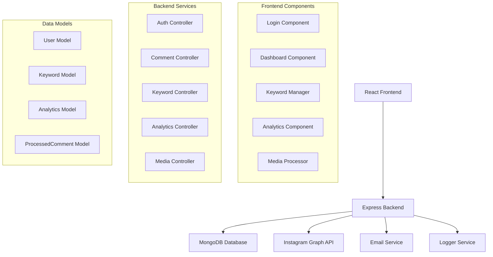

# Design Document

## Overview

The Instagram DM Automation Tool is a full-stack application built with React frontend and Node.js/Express backend. The system integrates with Instagram's Graph API to monitor comments and automatically send direct messages based on keyword matching. The architecture follows a RESTful API design with JWT authentication and MongoDB for data persistence.

## Architecture

### High-Level Architecture



### Technology Stack

- **Frontend**: React 19, React Router, Bootstrap, Axios
- **Backend**: Node.js, Express.js, MongoDB with Mongoose
- **Authentication**: JWT tokens, Instagram OAuth
- **External APIs**: Instagram Graph API
- **Additional Services**: Nodemailer for notifications, Winston for logging

## Components and Interfaces

### Frontend Components

#### 1. Authentication Flow Component
- **Purpose**: Handle Instagram OAuth flow and callback processing
- **Key Features**:
  - OAuth URL generation with proper scopes
  - Authorization code extraction from callback
  - Token exchange and storage
  - Error handling for authentication failures

#### 2. Enhanced Dashboard Component
- **Purpose**: Main user interface after authentication
- **Key Features**:
  - User profile display
  - Navigation between different sections
  - Real-time status indicators
  - Quick action buttons

#### 3. Media Processor Component
- **Purpose**: Allow users to manually trigger comment processing
- **Key Features**:
  - Media ID input validation
  - Processing status display
  - Results summary
  - Error feedback

#### 4. Enhanced Keyword Manager Component
- **Purpose**: CRUD operations for keyword-response pairs
- **Key Features**:
  - Add/edit/delete keywords
  - Response template with placeholders
  - Keyword validation
  - Bulk operations

#### 5. Enhanced Analytics Component
- **Purpose**: Display automation metrics and insights
- **Key Features**:
  - DM statistics
  - Keyword performance
  - Time-based charts
  - Export functionality

### Backend Controllers

#### 1. Enhanced Auth Controller
- **Endpoints**:
  - `POST /api/auth/instagram` - Handle OAuth callback
  - `GET /api/auth/user` - Get current user info
  - `POST /api/auth/refresh` - Refresh access token
- **Key Features**:
  - Token validation and refresh
  - User profile fetching
  - Session management

#### 2. Enhanced Comment Controller
- **Endpoints**:
  - `POST /api/comments/process/:mediaId` - Process comments for specific media
  - `GET /api/comments/history` - Get processing history
- **Key Features**:
  - Comment fetching with pagination
  - Keyword matching algorithm
  - DM sending with rate limiting
  - Duplicate processing prevention

#### 3. Keyword Controller (New)
- **Endpoints**:
  - `GET /api/keywords` - Get user's keywords
  - `POST /api/keywords` - Add new keyword
  - `PUT /api/keywords/:id` - Update keyword
  - `DELETE /api/keywords/:id` - Delete keyword
- **Key Features**:
  - CRUD operations
  - Validation and sanitization
  - Duplicate prevention

#### 4. Enhanced Analytics Controller
- **Endpoints**:
  - `GET /api/analytics/summary` - Get overall statistics
  - `GET /api/analytics/keywords` - Get keyword performance
  - `GET /api/analytics/timeline` - Get time-based data
- **Key Features**:
  - Aggregated statistics
  - Time-range filtering
  - Performance metrics

#### 5. Media Controller (New)
- **Endpoints**:
  - `GET /api/media/recent` - Get user's recent posts
  - `GET /api/media/:id/comments` - Get comments for specific post
- **Key Features**:
  - Media fetching
  - Comment preview
  - Processing status

## Data Models

### Enhanced User Model
```javascript
{
  instagramId: String (required, unique),
  accessToken: String (required),
  refreshToken: String,
  tokenExpiresAt: Date,
  username: String,
  email: String,
  profilePicture: String,
  isActive: Boolean (default: true),
  lastLogin: Date,
  createdAt: Date,
  updatedAt: Date
}
```

### Enhanced Keyword Model
```javascript
{
  userId: ObjectId (required, ref: User),
  keyword: String (required),
  message: String (required),
  isActive: Boolean (default: true),
  matchCount: Number (default: 0),
  lastUsed: Date,
  createdAt: Date,
  updatedAt: Date
}
```

### Enhanced Analytics Model
```javascript
{
  userId: ObjectId (required, ref: User),
  date: Date (required),
  dmsSent: Number (default: 0),
  commentsProcessed: Number (default: 0),
  keywordMatches: Number (default: 0),
  apiCallsMade: Number (default: 0),
  errors: Number (default: 0),
  processingTime: Number (default: 0)
}
```

### ProcessedComment Model (New)
```javascript
{
  userId: ObjectId (required, ref: User),
  commentId: String (required, unique),
  mediaId: String (required),
  commentText: String (required),
  commentAuthor: String (required),
  keywordMatched: String,
  responseMessage: String,
  dmSent: Boolean (default: false),
  dmSentAt: Date,
  error: String,
  processedAt: Date (default: Date.now)
}
```

## Error Handling

### API Error Handling Strategy

1. **Instagram API Errors**:
   - Rate limiting: Implement exponential backoff with jitter
   - Token expiration: Automatic refresh or re-authentication prompt
   - Permission errors: Clear user feedback and guidance
   - API unavailability: Graceful degradation with retry logic

2. **Database Errors**:
   - Connection failures: Automatic reconnection with circuit breaker
   - Validation errors: User-friendly error messages
   - Constraint violations: Proper conflict resolution

3. **Application Errors**:
   - Unhandled exceptions: Global error handler with logging
   - Validation errors: Input sanitization and validation
   - Business logic errors: Appropriate HTTP status codes

### Error Response Format
```javascript
{
  success: false,
  error: {
    code: "ERROR_CODE",
    message: "User-friendly error message",
    details: "Technical details for debugging",
    timestamp: "2025-01-08T10:30:00Z"
  }
}
```

## Testing Strategy

### Backend Testing

1. **Unit Tests**:
   - Controller functions with mocked dependencies
   - Model validation and methods
   - Utility functions and helpers
   - Authentication middleware

2. **Integration Tests**:
   - API endpoint testing with test database
   - Instagram API integration (with mocking)
   - Database operations
   - Authentication flow

3. **End-to-End Tests**:
   - Complete user workflows
   - OAuth authentication flow
   - Comment processing pipeline
   - Error scenarios

### Frontend Testing

1. **Component Tests**:
   - React component rendering
   - User interaction handling
   - State management
   - API integration

2. **Integration Tests**:
   - Component interaction
   - Routing functionality
   - Authentication flow
   - API communication

### Test Data Management

- Mock Instagram API responses
- Test user accounts and tokens
- Sample comment and media data
- Automated test data cleanup

## Security Considerations

### Authentication & Authorization
- JWT token validation on all protected routes
- Token refresh mechanism
- Secure token storage (httpOnly cookies for production)
- Instagram OAuth scope validation

### Data Protection
- Input validation and sanitization
- SQL injection prevention (using Mongoose)
- XSS protection
- Rate limiting on API endpoints

### API Security
- Instagram access token encryption at rest
- Secure environment variable management
- CORS configuration
- Request size limiting

## Performance Optimization

### Backend Optimization
- Database indexing on frequently queried fields
- Connection pooling for MongoDB
- Caching for frequently accessed data
- Batch processing for multiple comments

### Frontend Optimization
- Component lazy loading
- API response caching
- Debounced user inputs
- Optimistic UI updates

### Instagram API Optimization
- Request batching where possible
- Intelligent rate limit handling
- Efficient pagination
- Minimal data fetching

## Deployment Considerations

### Environment Configuration
- Separate configurations for development, staging, production
- Secure secret management
- Database connection strings
- Instagram API credentials

### Monitoring & Logging
- Application performance monitoring
- Error tracking and alerting
- API usage monitoring
- User activity logging

### Scalability
- Horizontal scaling capability
- Database sharding considerations
- Load balancing for multiple instances
- Queue system for background processing